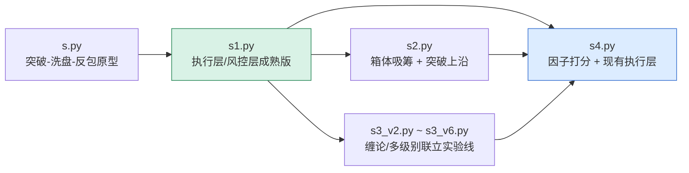
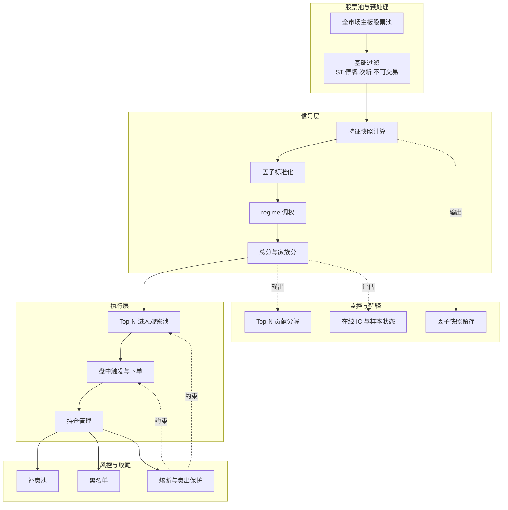
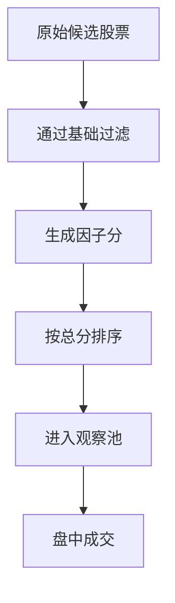

# 交易策略工程改进方案（面向 `s4.py` 落地）

> 目标读者：准备继续迭代 [s4.py](../joinquant/s4.py) 的工程实现者，而不是只看回测结论的研究者。  
> 本文重点不是“术语堆砌”，而是回答三个问题：**为什么前几版不够好、`s4.py` 应该继承什么、下一步该怎么改。**

---

## 0. 先说结论

当前脚本族的演进方向是对的：  
**`s.py / s1.py` 提供了稳定执行底座，`s2.py` 和 `s3*.py` 提供了不同信号实验，`s4.py` 试图把“选股逻辑”升级为“因子打分逻辑”。**

但到今天为止，主要问题还没彻底解决：

1. **信号层仍然没有完全数据化**  
   `s4.py` 虽然已经有因子框架，但前置闸门依然保留了较强的人工规则色彩。
2. **版本之间缺少“继承关系图”**  
   不看代码很难知道：哪些能力应该保留，哪些能力只是某一版试验。
3. **文档过于偏研究表达，不利于工程接手**  
   表格很多，但“怎么拆模块、先做什么、如何验证”讲得不够直接。
4. **`s4.py` 本身还没到可放心迭代的状态**  
   除开策略逻辑，脚本里还有注释/日志乱码与语法损坏问题，先得把“能跑、可读、可 review”恢复好。

所以，本文改成下面这个结构：

- 先看**脚本家族演进、继承关系与共同短板**
- 再看**`s4.py` 应该长成什么样**
- 最后给出**`s4.py` 的工程化落地路线**

---

## 1. 脚本家族演进、继承关系与共同短板

### 1.1 先看演进关系



这张图想表达一件事：

- **`s1.py` 是“底座”**：交易护栏、观察池、补卖池、持仓锁这些都很有工程价值。
- **`s2.py` 是单一思路试验**：说明“纯形态信号”可以快速迭代，但泛化弱。
- **`s3*.py` 是复杂信号试验**：说明“信号做得更复杂”不一定更好，反而容易把系统拖重。
- **`s4.py` 应该做的，不是推倒重来**，而是：  
  **保留 `s1.py` 的执行底座，吸收 `s2.py`/`s3*.py` 的经验教训，把信号层重构干净。**

---

### 1.2 一张总表看全局

| 脚本 | 主要目标 | 值得保留 | 主要缺点 |
|---|---|---|---|
| `s.py` | 跑通“突破-洗盘-反包”原型 | 观察池思路、盘中触发思路 | 参数拍脑袋、容量小、风险控制粗 |
| `s1.py` | 把原型做成可持续回测版本 | 主板池过滤、黑名单、死磕补卖池、同日卖出保护 | 入场/出场仍是硬编码规则拼接 |
| `s2.py` | 尝试“箱体吸筹 + 突破上沿” | 结构更直观，便于解释 | 信号过单一，容易漏掉趋势与量能背景 |
| `s3_v2.py` | 把买点改成缠论分钟级背驰 | 引入“信号新鲜度”和候选池概念 | 30 分钟级重计算太重，性能压力大 |
| `s3_v3.py` | 修复缠论版止损/止盈/结构过滤 | 明确暴露了 v2 的硬伤并给出修正 | 复杂度继续上升，维护成本高 |
| `s3_v4.py / v4-2.py` | 按市场状态切换参数集 | 开始考虑 regime（牛/震荡等） | 参数分支变多，策略解释成本大增 |
| `s3_v5.py` | 趋势市切到二买/三买 | 承认“抄底弱势”不是好边际 | 体系越来越复杂，验证难度越来越高 |
| `s3_v6.py` | 周/日/30 分钟多级别联立 | 级别职责更清楚 | 工程上已偏“重研究系统”，不适合快速落地 |
| `s4.py` | 因子打分接管信号层 | 因子库、打分、在线监控雏形 | 仍混有规则闸门，且代码可读性/可运行性还需修复 |

---

### 1.3 各代脚本的实际缺点，按共同短板归类

这一节不再按脚本逐个平铺，而是先看整个家族反复出现的共性问题，再把各版本的具体缺点挂到这些问题下面。这样更容易直接回答：**前几版到底差在什么地方，`s4.py` 又该替换什么、继承什么。**

#### 共同短板一：信号层普遍“强规则、弱排序”

前几代脚本大都在做这种事情：

- 设条件
- 过滤不满足条件的票
- 对剩余票做少量排序

这类策略的问题是：**过滤很强，排序很弱。**

而工程上真正好用的系统，往往反过来：

- 先保证候选池干净
- 再用统一打分做排序
- 最后由执行层按名次消费信号

这正是 `s4.py` 应该承担的角色。

##### 各脚本在这一短板上的具体表现

###### `s.py` / `s1.py`

问题不在执行层，而在**信号层仍是“布尔规则拼接”**：

```text
MA 多头排列
AND
日涨幅足够大
AND
量能放大
AND
次日/隔日再确认
```

这类写法的坏处有三个：

1. **很难知道哪条规则真的有贡献**
2. **阈值容易越调越玄学**
3. **一旦市场风格切换，整套规则会一起失效**

###### `s2.py`

`s2.py` 的核心逻辑是：

1. 先找 **20 日箱体**
2. 再看 **箱体上沿突破**
3. 盘中触发直接买入

它更像在问：

> “有没有突破箱体？”

但没有充分回答：

> “这个突破是不是强、是不是健康、是不是值得排在别的票前面？”

具体表现为：

- 过于依赖单一形态
- 缺少横向比较能力
- 20 日箱体、15% 波动等固定窗口容易只对某段行情有效

所以，`s2.py` 更适合作为**候选因子来源**，不适合作为**完整主信号**。

###### `s3*.py`

`s3` 系列虽然信号解释更深，但本质上仍更像在回答：

> “这里是不是一个买点？”

而不是：

> “今天全市场这么多票，先买哪几个？”

这意味着它对“点位判断”投入很多，但对“全市场排序”支持仍然不足。

#### 共同短板二：研究逻辑与执行逻辑耦合太紧

很多脚本里，选股、买入、止损、补卖、黑名单都揉在一个主流程里。

这样做短期开发很快，但长期维护会出现两个问题：

1. 改一个信号，容易误伤执行层
2. 很难单独测试“信号到底好不好”

##### 各脚本在这一短板上的具体表现

###### `s.py` / `s1.py`

`s.py` 和 `s1.py` 最大价值，不是“选股公式”，而是**交易执行上的工程能力**：

- 主板池过滤
- ST / 停牌 / 次新过滤
- `watch_pool` 观察池
- `pending_exit_stocks` 跌停补卖池
- 持仓锁
- 黑名单
- 同日卖出保护

这些能力非常像真实交易系统里的“护栏层”，不是随便写一版新信号就能替代的。问题在于，这套执行护栏和手工信号规则绑得太紧，导致后续很难只替换上层信号而保留下层执行底座。

###### `s3*.py`

`s3_v2.py` 到 `s3_v6.py` 基本是在用缠论、多级别联立、结构止损、市场状态切换，去修复“分钟级形态策略容易买错、卖早、性能差”的问题。

但当一个版本里同时出现：

- 周线过滤
- 日线买卖点
- 30 分钟 timing
- regime 切换
- 不同止损体系

一旦回测变差，就很难快速定位到底是哪一层出了问题。

#### 共同短板三：参数多，但配置化不足

典型参数包括：

- 观察池大小
- age 生命周期
- 止盈回撤比例
- 止损线
- 各类均线窗口
- regime 开关

如果这些参数散落在脚本常量里，后续做实验和复盘都会很痛苦。

##### 各脚本在这一短板上的具体表现

###### `s2.py`

箱体窗口、波动阈值这类参数高度依赖市场阶段，若不配置化，就很容易变成只对某一段行情有效的“局部最优”。

###### `s3*.py`

从 `v4` 开始加入 regime 分支，从 `v5`、`v6` 又叠加多级别与不同结构判断，参数数量持续增长；如果没有统一配置与验证框架，维护成本会迅速失控。

#### 共同短板四：可观测性不足

回测里经常只看到“收益变好了/变坏了”，但不知道：

- 当天为什么选了这只
- 哪个因子贡献最大
- 是信号变差，还是执行拖累

##### 各脚本在这一短板上的具体表现

###### `s.py` / `s1.py` / `s2.py`

这些版本大多能告诉你“买了什么”或“满足了什么条件”，但很难系统解释：

- 为什么它比别的票更优先
- 某次失败是规则判断失误，还是执行与风控拖累

###### `s3*.py`

`s3` 系列虽然研究表达更丰富，但因为结构太复杂，回头看结果时反而更难快速抽出最关键的解释变量。

###### `s4.py`

`s4.py` 已经开始做这件事（因子快照、在线监控），方向是对的，但还要继续完善。

#### 补注：各脚本里不完全属于共同短板、但仍值得保留或提醒的点

##### `s.py` / `s1.py`

面向 `s4.py` 的继承结论很明确：

- 不该被替换掉的是：股票池过滤、观察池生命周期、补卖池与跌停处理、持仓与卖出保护
- 应该被替换掉的是：“满足三个条件就入池”的选股方法，以及“固定阈值止盈止损”的一刀切解释

##### `s2.py`

`s2.py` 最适合被拆成 2~3 个因子，而不是整套照搬：

- `box_range_compression`：箱体收敛程度
- `box_breakout_strength`：突破强度
- `box_breakout_volume_confirm`：突破时量能确认

##### `s3*.py`

`s3` 系列最值得继承的，不是缠论公式本身，而是这些工程意识：

1. **级别职责必须清楚**
2. **止损逻辑不能和入场假设打架**
3. **性能预算要前置考虑**
4. **市场状态切换是必要的，但要尽量轻量**

换成 `s4.py` 的语言就是：

- 因子负责排序
- 规则负责执行
- 风控负责兜底
- regime 只做权重调整，不要把主逻辑切成太多套

另外，`s3` 系列从 `v2` 到 `v6` 还暴露了一个额外事实：脚本很容易从“交易脚本”膨胀成“研究平台”。这不是共同短板中的某一项单独能概括的，但对 `s4.py` 的边界控制很重要。

---

## 2. `s4.py` 应该长成什么样

### 2.1 目标架构图



### 这张图有两个关键点

#### 关键点 1：**选股排序**和**交易执行**分层

- 上半部分回答“该看谁”
- 下半部分回答“什么时候动手、出了事怎么收尾”

#### 关键点 2：regime 只做“调权”，不做“完全换脑”

这是 `s4.py` 比 `s3_v4/v5/v6` 更适合落地的原因。  
它不需要在牛市、熊市、震荡市里维护三套完全不同的交易哲学，而是：

- 牛市：趋势/动量/量能权重更高
- 熊市：反转/波动保护权重更高
- 震荡：相对均衡

---

### 2.2 `s4.py` 当前已经有的好东西

从代码结构看，`s4.py` 已经具备这些正确方向：

1. **有统一因子注册表**
2. **有特征构建函数**
3. **有因子打分与家族分解**
4. **有在线因子监控雏形**
5. **保留了 `s1.py` 的执行层护栏**

这说明 `s4.py` 不是从零开始写，而是已经进入“可工程化”的阶段。

---

## 3. `s4.py` review：当前最需要处理的问题

### 3.1 阻塞级问题（先修，不修没法稳定迭代）

### 问题 A：脚本存在语法损坏

当前版本里，部分乱码日志把字符串截断了，导致脚本**不能通过语法检查**。  
这类问题优先级最高，因为它不是“策略优不优秀”，而是“脚本能不能运行”。

### 问题 B：顶部注释乱码

开头注释已经不能准确表达脚本目的，影响接手和 review。  
这类问题虽然不影响收益，但会显著降低可维护性。

### 问题 C：日志中仍有明显乱码

运行后即使逻辑正确，日志里如果大量乱码，也会让排查问题成本上升。

---

### 3.2 设计级问题（脚本能跑后，下一步应该处理）

### 问题 D：因子框架外面仍包着“强规则闸门”

`s4.py` 目前虽然有因子打分，但在入池前仍有类似：

- 多头排列
- 单日涨幅下限
- 成交量放大

这样的前置闸门。

这会带来一个后果：

> 你以为在验证因子，实际上只是在验证“规则筛过后的因子”。

建议做法：

- **基础交易约束**保留：不可交易、ST、次新、停牌、极端波动
- **信号约束**逐步因子化：趋势、量能、突破强弱不要再硬闸掉

### 问题 E：观察池里的 `breakout_price` 会被向上抬高

当前逻辑会在刷新观察池时，把 `breakout_price` 和最新快照做 `max()`。  
这会让“突破参考价”越来越高，可能产生两个副作用：

1. 原本只是等待回踩确认，最后变成“越涨越要更高价确认”
2. 观察池含义从“记录原始突破基准”变成“不断追认新高”

如果策略本意是“围绕初始突破做二次确认”，那这里应该把：

- **原始突破基准**
- **最新强势参考价**

拆成两个字段，而不是混成一个。

### 问题 F：因子在线监控快照有“丢样本”风险

监控快照在未来收益样本不足时，存在直接跳过的情况。  
这会让在线因子评估偏向“容易拿到数据的样本”，长期看会影响监控质量。

更稳妥的做法是：

- 样本不足时继续保留快照，等待下一交易日再评估
- 或者显式记录“样本不足，未计入统计”

### 问题 G：`s4.py` 的解释性还不够强

虽然已经有：

- `signal_score`
- `family_scores`
- `factor_breakdown`

但还缺少“工程上能直接看懂”的输出，例如：

- 当天 Top10 入池股票及前三大贡献因子
- 被淘汰股票的主要原因
- 当月被降权/停用因子的名单

---

## 6. 面向工程实现的改造路线

## 6.1 第一阶段：先恢复“能跑、能看、能查”

目标不是提高收益，而是恢复工程可维护性。

### 要做的事

1. 修复 `s4.py` 语法错误
2. 修复开头注释乱码
3. 清理关键运行日志乱码
4. 通过最小语法检查

### 交付标准

- 脚本可被解释器加载
- 初始化日志可读
- 买入/卖出/熔断/补卖等关键日志可读

---

## 6.2 第二阶段：把“规则闸门”逐步并入因子框架

### 原则

不是一次性删光规则，而是分三类处理：

| 类型 | 是否保留 | 例子 |
|---|---|---|
| 交易约束 | 保留 | ST、停牌、上市天数、最小成交单位 |
| 风控约束 | 保留 | 持仓锁、补卖池、熔断、同日卖出保护 |
| 信号约束 | 逐步因子化 | 多头排列、量能放大、突破强弱 |

### 结果

最终 `passes_signal_guard()` 应该越来越薄，主要只做“最低可交易前提”。

---

## 6.3 第三阶段：把 `s2.py` / `s3*.py` 的经验吸收到因子库

这里不是“合并脚本”，而是“提炼因子”。

### 来自 `s2.py` 的候选因子

- 箱体压缩度
- 箱体上沿突破幅度
- 箱体突破量能确认

### 来自 `s3*.py` 的候选因子

- 多周期趋势一致性
- 回撤后再转强程度
- 结构止损距离
- 波动收缩后扩张

### 工程提醒

这些因子进入 `s4.py` 时，必须满足两条：

1. 能批量计算
2. 能解释，不要把缠论整套状态机原样搬进实时主流程

---

## 6.4 第四阶段：把输出做成“工程可读”

建议每个交易日输出三个层次的信息：



并给出对应摘要：

1. **候选层**：今天一共看了多少只
2. **排序层**：Top-N 为什么高分
3. **执行层**：哪些票真正成交、哪些被风控拦掉

这样后面无论优化研究还是排查 bug，都会快很多。

---

## 7. 推荐的工程拆分方式

如果后续允许继续拆文件，建议 `s4.py` 最终拆成下面几块：

| 模块 | 职责 |
|---|---|
| `universe.py` | 主板池、基础过滤 |
| `features.py` | K 线特征构建 |
| `factors.py` | 因子注册与计算 |
| `signal_model.py` | 因子标准化、权重、总分计算 |
| `monitor.py` | 在线 IC / 单调性 / 因子状态 |
| `execution.py` | 观察池、盘中触发、下单 |
| `risk.py` | 止盈止损、补卖池、黑名单、熔断 |

如果短期内不拆文件，也建议至少在一个脚本内按这 7 个区块重新整理。

---

## 8. 术语解释（尽量说人话）

| 术语 | 通俗解释 |
|---|---|
| 因子 | 一个可量化的选股特征，比如“今天涨得强不强”“量有没有放大” |
| 因子打分 | 把多个特征统一算成分数，再决定谁排前面 |
| regime | 市场环境，比如偏牛、偏熊、偏震荡 |
| 观察池 | 先关注但还没真正买入的股票列表 |
| 补卖池 | 因跌停等原因当天没卖掉，需要第二天继续处理的股票列表 |
| IC | 因子分数和未来收益的相关性，越稳定越好 |
| ICIR | IC 的稳定度指标，可粗看成“这因子是不是经常有效” |

---

## 9. 最终建议：`s4.py` 的定位要稳住

`s4.py` 不应该再变成另一个 `s3_v6.py`。

也就是说，它的目标不是：

- 再引入一大套更复杂的图形理论
- 再加三层条件和五套模式切换

而是：

1. **用因子排序替代手工规则拼接**
2. **保留 `s1.py` 的成熟执行底座**
3. **把 `s2.py`/`s3*.py` 的经验提炼成轻量因子或风控约束**
4. **把系统做成能解释、能验证、能迭代的工程产物**

如果按这个方向走，`s4.py` 才会成为真正可持续的主线版本。

---

## 10. 下一步的最小行动清单

### 立即做

- [x] 重写本文档结构，补齐 `s2.py`、`s3*.py` 的分析
- [x] 明确 `s4.py` 的定位和演进边界
- [x] 修复 `s4.py` 的可运行性问题
- [x] 清理 `s4.py` 关键日志乱码

### 本周内做

- [x] 将 `passes_signal_guard()` 中的强信号闸门逐步瘦身
- [x] 增加每日 Top-N 因子贡献日志
- [x] 拆分“原始突破价”和“最新强势参考价”
- [x] 修复因子监控快照的样本保留逻辑

### 后续再做

- [x] 吸收 `s2.py` 的箱体因子
- [ ] 吸收 `s3*.py` 的轻量结构因子
- [ ] 做 walk-forward / 样本外验证

### 后续优先级建议（滚动更新）

> 说明：这个小节用于记录每一轮做完后的“下一步优先顺序”。旧版本不删除，用删除线保留；新版本追加在下面。

~~
## 我对后续优先级的建议
如果继续往前做，我建议优先顺序是：

1. 继续补主线因子  
   把 `s3*.py` 里适合轻量化的经验继续因子化，而不是搬整套缠论流程。

2. 继续增强候选/淘汰日志  
   目前已有“入池摘要”，下一步最值钱的是“淘汰摘要”。

3. 最后再考虑更大拆分  
   比如把 `s4.py` 拆成 feature/factor/monitor/execution/risk 模块。
~~

#### 2026-10-11 更新

## 我对后续优先级的建议
如果继续往前做，我建议优先顺序是：

1. **继续吸收 `s3*.py` 的轻量结构因子**  
   重点提炼“可批量计算、可解释、不会把主流程拖重”的结构信息，例如：
   - 趋势一致性
   - 回撤后再转强程度
   - 轻量化的波动收缩/扩张特征

2. **补“淘汰摘要”与“拦截原因摘要”日志**  
   现在已经有“候选摘要/入池摘要”，下一步应该补：
   - 为什么没进观察池
   - 为什么进了观察池却没在盘中成交
   - 为什么被风控挡掉

3. **做样本外验证与 walk-forward**  
   主线框架已经比之前稳定很多，接下来要尽早验证：
   - 新增因子是不是只在样本内有效
   - 权重和阈值是否有过拟合倾向

4. **最后再考虑拆模块**  
   等主流程更稳定后，再把 `s4.py` 拆成 `features.py / factors.py / monitor.py / execution.py / risk.py`，避免边拆边改带来额外噪声。
